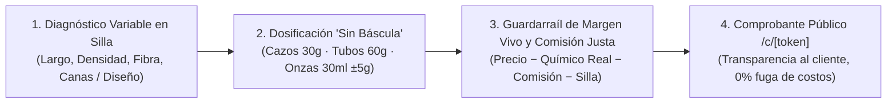

# Inteligencia Competitiva y Benchmarking Estratégico · Veli Colombia y LatAm (2026)

> **Frente:** Fase 6 (`AGENTE 5`) · Inteligencia Competitiva Local, Regional e Internacional  
> **Fecha de corte:** `2026-11-27`  
> **Cobertura auditada:** **21 actores/pares competitivos** (`8` directos en Colombia/LatAm, `4` herramientas indirectas de uso masivo en Colombia y `9` referentes internacionales de software vertical) y **38 estructuras tarifarias verificadas** (`competitor_pricing.csv`).  
> **Tasa de referencia para homologación internacional:** `1 USD = 4.200 COP` (enteros redondeados en `competitor_pricing.csv`, manteniendo siempre la moneda original publicada `COP` o `USD`).

---

## 1. Mapa Estructural del Mercado: ¿Contra quién compite realmente Veli en Colombia?

En la práctica operativa de los establecimientos de belleza y bienestar en Colombia (`hair_studio`, `barber_studio`, `nail_bar`, `spa_estetica`, `beauty_lounge`), la competencia no es homogénea. El salón colombiano elige —o queda atrapado— entre **cuatro arquitecturas** con incentivos económicos opuestos:

| Arquitectura competitiva | Actores auditados | Modelo de monetización | Realidad en Colombia (2025–2026) |
|---|---|---|---|
| **A. Stack Fragmentado Informal (El verdadero incumbente del ~80% del mercado)** | **WhatsApp Business + Google Calendar** + cuaderno/Excel + **Bold** / **Treinta** + **Alegra / Siigo** | `$0 COP` en software de agenda; `2,69%–3,49%` en cobros electrónicos; `$25.900–$163.900 COP/mes` si factura electrónicamente | Altísima cercanía por WhatsApp, pero **cero trazabilidad financiera en silla**, cotizaciones «a ojo», choques de agenda, horas perdidas respondiendo chats de noche y fugas invisibles de químico y comisiones. |
| **B. Marketplaces de Captación con Peaje** | **Fresha**, **Booksy (Biz + Boost)**, *Wonoma / Treatwell (ref. AR/EU)*, *Mindbody* | Suscripción mensual en **USD** (`$14.95–$29.99+ USD`) **+** comisión del **`20%` al `35%`** sobre la primera visita de cada cliente nuevo + pagos/mensajes medidos | Prometen «llenar sillas», pero en 2025–2026 **eliminaron la gratuidad** (Fresha ahora cobra suscripción mensual por miembro + `20%` de peaje) o castigan el crecimiento por silla (Booksy suma `+$20 USD/mes` por barbero/estilista + `30%` en Boost), commoditizando al salón dentro de un directorio donde compite por descuento contra el vecino. |
| **C. SaaS / ERPs Horizontales LatAm** | **AgendaPro**, **Bewe**, **Kumbio**, **Tulook**, *Belasis / Trinks (Brasil)* | Suscripción escalonada (`$29.900–$510.000 COP/mes` o `$9–$89 USD/mes`) + recargos por bloques de WhatsApp, IA, facturación o pasarela | Digitalizan calendario, fichas y caja básica, pero arrastran **costos ocultos en Colombia** (AgendaPro incluye solo `50` WhatsApps/mes y cobra **`1%–2% + IVA` propio encima de Mercado Pago**) y tratan un tinte o balayage igual que una consulta odontológica: recetas estáticas sin diagnóstico variable ni control «Sin Báscula». |
| **D. SaaS Verticales Modernos Anglosajones (Referentes UX, ausentes en CO)** | **GlossGenius**, **Mangomint**, **Boulevard**, **SQUIRE**, **Vagaro**, **Phorest**, **Zenoti**, **Square Appointments** | `$24–$600+ USD/mes` por sede + procesamiento integrado obligatorio (`2,29%–3,50%`) + add-ons (`$10–$300 USD/mes`) | Marcan el estándar mundial en diseño de interfaz (*slide-overs* de Mangomint, *Front Desk* de Boulevard, *Commander* móvil de SQUIRE, *guest checkout* de GlossGenius), pero **no operan en Colombia**, dependen de SMS estadounidense (`+1`) y *Card on File*, y **ninguno resuelve nativamente el gramaje químico sin comprar básculas Bluetooth de terceros (`Vish` o `SalonScale`)**. |

---

## 2. Uso Real vs. «Bloatware»: Qué usan los salones todos los días y por qué abandonan el software tradicional

Al cruzar los módulos empaquetados por ERPs grandes (Mindbody, Zenoti, Boulevard Prestige, AgendaPro Pro) contra la operación diaria real de un estudio de 1 a 15 sillas en Colombia, emerge una asimetría contundente: **los dueños pagan por 30 módulos, pero el 92% del valor económico ocurre en 5 flujos diarios de menos de 30 segundos**.

### 2.1 Los 5 módulos de misión crítica diaria (Alta frecuencia / Alto ROI)
1. **Recepción y Agenda Viva en hora local (`America/Bogota`):** Ver quién viene hoy, quién está en silla, huecos disponibles reales y tiempos de pose donde el especialista puede atender otro corte/cepillado.
2. **Confirmación y Reagendamiento por WhatsApp (`+57`):** En Colombia, el correo electrónico transaccional tiene tasas de apertura marginales en servicios personales y el SMS se asocia con spam bancario. WhatsApp es el único canal que reduce inasistencias (*no-shows*) de forma inmediata.
3. **Cotización Técnica Antes de Tocar el Cabello / Uña / Cabina:** Aterrizar frente al cliente cuánto va a costar exactamente el servicio según largo, densidad, estado previo o diseño —eliminando la pelea en recepción al momento de pagar.
4. **Cierre de Caja Ágil Multi-Método Colombiano:** Registrar en un toque pagos reales del país (**Efectivo, Nequi, Daviplata, PSE, transferencia Bancolombia, datáfono/link Bold o pago mixto**) sumando reventa retail si el cliente lleva un champú o tratamiento.
5. **Liquidación Transparente de Comisiones y Nómina Quincenal:** Que tanto el dueño como el especialista confíen al centavo en el corte quincenal/semanal sin cruzar cuadernos ni hojas de cálculo el sábado a las 8:00 p. m.

### 2.2 El «Bloatware» que infla precios y frena la adopción en silla
- **Constructores de Apps Móviles «Marca Blanca» en App Store / Google Play** (Mindbody, Phorest Ultimate, Vagaro, SQUIRE Titan, Bewe): ningún cliente colombiano descarga una app nativa pesada solo para pedir cita cada 35 días en un salón cuando puede abrir un enlace instantáneo (`/s/[slug]`) desde Instagram o WhatsApp sin crear contraseña.
- **Suite de Email Marketing Complejo y Embudos de Leads CRM Corporativos** (Mindbody Ultimate, Boulevard, Mangomint `$30–$300 USD/mes`): diseñados para gimnasios estadounidenses; en estudios colombianos bastan alertas accionables de **ciclo de retorno vencido** (`+30 / +45 / +60 días sin visita`) disparadas a WhatsApp.
- **Órdenes de Compra ERP Multi-Bodega y Contabilidad NIIF Completa Dentro del Software de Silla:** obliga a recepcionistas o estilistas a navegar pantallas contables densas. En Colombia, el contador externo exige trabajar en **Siigo o Alegra**; el salón necesita un libro operativo inmutable de ingresos, insumos y comisiones que exporte limpio al contador, no un clon contable lento.
- **Módulos de Telemedicina / Clases por Zoom** (AgendaPro `$45.600 COP/mes`, Bewe, Mindbody): irrelevantes para las 5 verticales presenciales de belleza, pero subsidiados en la complejidad de la interfaz.

---

## 3. La Trampa Económica de los Marketplaces (`20%–35%` de Comisión + Doble Peaje)

Plataformas como **Fresha**, **Booksy (con Boost)**, **Mindbody** y **Treatwell** venden la narrativa de que cobrar entre el **`20%` y el `35%`** de la primera cita «es costo de adquisición solo por traer un cliente nuevo». Sin embargo, al auditar la estructura de costos reales de un salón colombiano en 2025–2026, esa comisión opera como una **trampa destructora de capital de trabajo** por cuatro razones verificadas:

### 3.1 Demostración numérica sobre un servicio real en Colombia (`Balayage Completo` · `$380.000 COP`)
Tomemos la mediana sugerida de mercado en Veli para un `hair-balayage-completo` (`$380.000 COP`, 240 min en silla) bajo el esquema de comisión predominante en Colombia (`40%` sobre valor bruto del servicio) cuando el cliente entra por marketplace:

| Concepto financiero (1.ª visita de cliente nuevo) | Vitrina Propia Veli (`/s/[slug]`) | Fresha Marketplace (`20%` fee) | Booksy Boost (`30%` fee) |
|---|---:|---:|---:|
| **Precio cobrado al cliente** | **`$380.000`** | **`$380.000`** | **`$380.000`** |
| `(−)` Costo químico + desechables reales (decolorante + peróxido + matiz + aluminio/guantes) | `-$62.000` | `-$62.000` | `-$62.000` |
| `(−)` Comisión especialista (esquema tradicional `40%` s/bruto) | `-$152.000` | `-$152.000` | `-$152.000` |
| `(−)` Procesamiento electrónico de pago (`~3,0%` ref.) | `-$11.400` | `-$11.400` | `-$11.400` |
| `(−)` **Peaje de Marketplace sobre 1.ª cita** | **`$0` (`0%`)** | **`-$76.000` (`20%`)** | **`-$114.000` (`30%`)** |
| **`(=)` Contribución antes de arriendo, servicios y recepción (4 h de silla)** | **`$154.600` (`40,7%`)** | **`$78.600` (`20,7%`)** | **`$40.600` (`10,7%`)** |
| `(−)` Costo fijo indirecto asignado (`4 horas` de silla × `~$18.000 COP/hora` estudio estándar) | `-$72.000` | `-$72.000` | `-$72.000` |
| **`(=)` Utilidad Operativa Real para el Estudio** | **`+$82.600` (`+21,7%`)** | **`+$6.600` (`+1,7%`)** | **`-$31.400` (`-8,3%` PÉRDIDA)** |

> **Hallazgo crítico:** Con Booksy Boost (`30%`), el dueño del estudio **pierde `-$31.400 COP` reales** por trabajar 4 horas en un balayage nuevo; con Fresha (`20%`), apenas empata (`+$6.600 COP`, menos de `$1.700 COP` por hora de silla). Y si en Veli además se aplica comisión sobre neto químico (`40%` sobre `$380.000 - $62.000 = $127.200`), la utilidad operativa del estudio sube a **`+$107.400 COP` (`28,3%`)**.

### 3.2 El fin del «Software Gratis» y la canibalización del tráfico propio
1. **Doble cobro desde 2025–2026:** Fresha eliminó su histórico plan gratuito y ahora exige **`$19.95 USD/mes`** (independiente) o **`$14.95 USD/mes por cada profesional reservable`**, además del **`20%` (mínimo `$6 USD`)** por cliente nuevo, procesamiento de pagos y recargas de mensajería.
2. **Fuga de atribución del propio Instagram del salón:** Documentación verificada de Fresha confirma que si un cliente descubre o busca el nombre del salón dentro de la app/web de Fresha —incluso después de haber visto un Reel pagado por el salón en Instagram—, se activa el cargo del `20%` como «cliente nuevo del marketplace».
3. **El cliente pasa a ser activo del directorio, no del estudio:** Una vez que el cliente instala la app de Fresha o Booksy para reservar en el Salón A, la aplicación le notifica promociones, disponibilidad inmediata y precios más bajos de los Salones B, C y D ubicados a tres cuadras. El salón financia con su margen la construcción de la base de usuarios de su propio agregador.

---

## 4. El Vacío Mundial Triple: Por qué NINGÚN competidor resuelve Cotización Variable + «Sin Báscula» + Margen Neto Real

La auditoría rigurosa de los **21 competidores** (`competitor_features.csv`) demuestra que **cero (`0/21`) plataformas en Colombia, Latinoamérica o el mercado global combinan de forma nativa los tres pilares nucleares de Veli**:

### 4.1 Falla 1: El problema global del `"$275+"` y `"Price Varies"`
Incluso en los mejores referentes estadounidenses auditados en `VELI_DESIGN_BENCHMARK.md`, el manejo de servicios complejos está roto:
- **GlossGenius** solo ofrece dos interruptores binarios: **`Starting Price (+)`** o **`Price Hidden ("Price Varies")`**. Estudios reales auditados en EE.UU. (`panistyle.glossgenius.com`, `greggala.glossgenius.com`) se ven obligados a redactar párrafos defensivos advirtiendo que el precio incluye un solo *bowl* de mezcla y que cobrarán **`$25 USD` por cada *bowl* adicional**.
- **AgendaPro, Bewe, Fresha y Booksy** obligan a duplicar el catálogo en decenas de ítems rígidos (*Balayage corto*, *Balayage medio*, *Balayage largo*, *Balayage extra largo*) que aun así no capturan la combinación real de **largo × densidad × estado sensibilizado × porcentaje de canas**.
- **Ventaja Veli:** El Workspace Silla permite diagnosticar en 4 toques frente al cliente, calcular un precio paramétrico defendible y enviar por WhatsApp el comprobante `/c/[token]` antes de preparar la mezcla, eliminando sorpresas en caja y manteniendo bajo llave los costos internos.

### 4.2 Falla 2: Por qué las básculas Bluetooth (`Vish` / `SalonScale`) no escalan en LatAm y por qué gana «Sin Báscula»
En Norteamérica y Europa, **Phorest, Boulevard, Mangomint, Vagaro, Zenoti y Square Appointments** no resuelven el control de gramos químicos en su código base; lo delegan a integraciones de terceros con hardware físico:
- **SalonScale** cuesta entre **`$49 USD/mes` (1 estilista)** y **`$199 USD/mes` (ilimitado)** —y en el caso de Phorest exige el nivel *Luxe* de `$199 USD/mes` o un add-on pago para sincronizar con el POS—, más la compra de una báscula Bluetooth e iPad dedicados en el *color bar*.
- **Vish** opera bajo cotización corporativa + básculas Bluetooth + iPad en estación de mezcla.
- **Por qué fracasa ese enfoque en Colombia y LatAm:**
  1. Sumar `$99–$199 USD/mes` (`$415.000–$835.000 COP/mes`) + hardware importado supera el presupuesto total de tecnología del 95% de los salones latinoamericanos.
  2. Cultural y operativamente, en hora pico de viernes o sábado en Bogotá, Medellín o Cali, los coloristas y manicuristas **no se detienen a tarar una báscula Bluetooth por cada tubo o peroxido**. Cuando la herramienta exige pesar en gramos exactos, el equipo la esquiva a la segunda semana.
- **La innovación estructural de Veli («Sin Báscula»):** Traduce instantáneamente el diagnóstico técnico a **unidades físicas naturales del oficio** (`cazos rasos de 30g`, `medios tubos / tubos de 60g`, `onzas de 30ml` y proporciones exactas de peróxido `1:1` / `1:1.5` / `1:2`) con ajuste táctil rápido de **`-5g / +5g`** en `JetBrains Mono`. Captura el desvío real entre consumo teórico y real con **`$0` en hardware** y en menos de 10 segundos.

### 4.3 Falla 3: Deducciones estáticas de comisión vs. Costo químico vivo + Margen por hora
- En **Fresha, Booksy, GlossGenius, SQUIRE, Kumbio y Square**, las comisiones se calculan sobre la venta bruta del servicio. Si el estilista prepara el doble de decolorante por descuido, **su comisión sigue intacta (`$152.000 COP`) mientras el dueño absorbe el 100% del sobrecosto químico**.
- En **Vagaro, Mangomint y Zenoti**, aunque existe la función avanzada de descontar un *Service Cost / Shop Cost* antes de liquidar la comisión, dicho descuento es **un monto plano o porcentaje estático preconfigurado**, desconectado de si ese cliente específico tenía cabello corto de baja densidad (`60g`) o extra largo abundante (`180g`).
- En **AgendaPro y Bewe**, el descuento de inventario por receta descuenta cantidades fijas promedio post-venta, sin alertar en vivo en silla cuando un descuento comercial o un cabello XL hunde el margen neto por debajo del umbral saludable (`<30%`).

---

## 5. Radiografía de Costos Ocultos en Colombia (TCO Real para un Estudio de 4 Especialistas)

Uno de los hallazgos más potentes para ventas B2B de Veli en Colombia es exponer la diferencia entre el **«precio gancho anunciado»** y el **Costo Total Mensual Real (TCO)** para un estudio típico de **4 especialistas** que atiende **220 citas al mes** (~350 mensajes de WhatsApp entre confirmaciones, recordatorios y reactivaciones, `15` clientes nuevos/mes a ticket medio de `$140.000 COP` y `$28.000.000 COP` procesados):

| Plataforma | Cuota Software Base (4 esp.) | Excedente WhatsApp / SMS (350 msg) | Peaje Clientes Nuevos / Recargo Propio Pagos | **Costo Mensual Software + Peajes Propios (sin pasarela bancaria base)** | Riesgo Cambiario / Fricción Local |
|---|---:|---:|---:|---:|---|
| **AgendaPro (Premium CO)** | `~$180.000–$220.000 COP` *(base $150k + prof.)* | **`+$60.000 COP`** *(300 msg extra = 6 lotes × $10k)* | **`+$280.000 a $560.000 COP`** *(1%–2% + IVA extra si cobra $14M–$28M online)* | **`$520.000 – $840.000 COP / mes`** | En COP, pero **doble comisión** en pagos online y WhatsApp racionado de a 50 mensajes. |
| **Fresha (Team 4 staff)** | **`$251.200 COP`** *(`4 × $14.95 = $59.80 USD`)* | `~$35.000–$60.000 COP` *(créditos extra sobre cupo corto)* | **`+$420.000 COP`** *(15 clientes nuevos × `$140k` × `20%`)* | **`$706.200 – $731.200 COP / mes`** | Facturado en **USD (TRM)**; sin PSE ni Nequi nativos; directorio expone clientes a competencia. |
| **Booksy Biz (+ Boost)** | **`$378.000 COP`** *(`$29.99 + 3×$20 = $89.99 USD`)* | `$0` *(usa push app, sin WhatsApp nativo)* | **`+$630.000 COP`** *(si 15 clientes nuevos entran vía Boost `30%`)* | **`$378.000 – $1.008.000 COP / mes`** | Facturado en **USD (TRM)**; penaliza crecer el equipo (`+$84.000 COP/mes` por cada silla nueva). |
| **Bewe (Growth 5 staff)** | **`$247.800 COP`** *(`$59 USD`)* | Variable *(según uso de Linda IA / campañas)* | `$0` *(comisión marketplace 0%)* | **`$247.800 – $373.800 COP / mes`** | Referenciado en **USD**; sin cotizador variable ni protección de margen químico. |
| **Mangomint (6 logins + Mkt)** | **`$756.000 COP`** *(`$120 + 6×$10 = $180 USD`)* | **`+$126.000 COP`** *(paquete Mkt `$30 USD`, solo SMS +1)* | `$0` *(pero exige SalonScale `+$625.800 COP` para gramos)* | **`$882.000 – $1.507.800 COP / mes`** | No opera en Colombia; requiere tarjeta EE.UU. y no soporta WhatsApp ni COP. |

---

## 6. Estrategia Competitiva Recomendada para Veli en Colombia y LatAm

### 6.1 Posicionamiento de Categoría («Category Design»)
Veli **no** debe presentarse como «otro software de agenda para peluquerías» (donde pelearía por precio contra Kumbio `$9 USD` o contra el plan Individual de AgendaPro `$29.900 COP`). Su posicionamiento único y verificable es:

> **«Veli: El sistema de cotización inteligente, control de insumos Sin Báscula y agenda con vitrina propia (0% comisión) diseñado para proteger la ganancia real de estudios de belleza y barberías en Latinoamérica.»**

**Promesa económica demostrable en la primera semana:** Con solo evitar **3 balayages o keratinas subcotizados al mes** (`+$45.000 COP` recuperados por diagnóstico de largo/densidad) y reducir **15% de merma química** con *Sin Báscula*, Veli se paga solo varias veces al mes antes siquiera de contar las citas nuevas captadas en `/s/[slug]`.

### 6.2 Estrategia de Precios y Empaquetamiento SaaS frente a los rivales
1. **100% en Pesos Colombianos (COP), sin impuesto al crecimiento por silla:** Evitar el modelo punitivo de Booksy (`+$20 USD` por profesional) y Fresha (`$14.95 USD` por miembro). Mantener planes claros por estudio/rango amplio de equipo en COP fijos.
2. **0% Comisión de Marketplace y 0% Sobre-peaje de Pagos:** Jamás cobrar el `20%–30%` sobre clientes nuevos ni el `1%–2%` adicional que cobra AgendaPro encima de la pasarela. El dinero de Bold/PSE/Nequi entra directo al comercio pagando únicamente la tarifa transparente del procesador (`lib/payments/bold.ts`).
3. **WhatsApp sin ansiedad de micro-lotes de 50 mensajes:** Integrar enlaces profundos instantáneos (`wa.me` prellenados con `/c/[token]` y confirmaciones de `/s/[slug]`) a costo `$0` en todos los planes, y en automatizaciones Cloud API aprovechar que los mensajes de **Utilidad en Colombia cuestan apenas `~$3 COP` (`$0.0008 USD`)** en Meta —donde competidores como AgendaPro revenden cada mensaje a **`$200 COP`** (`$10.000 COP / 50`), multiplicando por **66x** el costo mayorista de Meta—.

### 6.3 Estrategia de Entrada («Wedge») por Vertical
- **Cuña Primaria (`hair_studio` — Estudios de Colorimetría y Alisados):** Es el segmento con el dolor financiero más agudo e inmediato de Colombia (tickets de `$150.000` a `$950.000 COP`, alta merma en decolorante/tinte/keratina y conflicto constante entre precio «Desde» y gramaje real). Aquí *Workspace Silla + Sin Báscula + `/c/[token]`* no tiene sustituto en el mercado.
- **Cuña Secundaria (`nail_bar` y `spa_estetica`):** Apalancar la matriz de variantes estructuradas (largo de uña `#1–#5`, nivel de *nail art*, paquetes de sesiones corporales con control de saldo y guardarraíl normativo INVIMA/MinSalud) y las alertas automáticas de retorno a `21 días` (uñas/pestañas) y `30 días` (facial).
- **Cuña Terciaria (`barber_studio` de Autor y Multi-Silla):** Competir directamente contra Booksy Biz eliminando todo sesgo visual femenino (Base Neutra Veli `#111111` / `#FAFAFA`, presets grafito en `brand_settings`, copy neutro *Cliente / Especialista / Estudio*) y desplegando la vista móvil **`Mis Ganancias`** inspirada en *SQUIRE Commander* (aislada por RLS) a mitad del costo en COP de Booksy para equipos de 4+ barberos.

### 6.4 Estrategia de Ecosistema con los Indirectos Colombianos (Aliarse, no Reconstruir)
- **Con Bold (`COMP-bold`):** Potenciar la integración nativa para que el salón cobre anticipos anti-inasistencia con **PSE, Nequi o tarjeta** en `/s/[slug]` y concilie automáticamente en caja sin digitar recibos dos veces.
- **Con Alegra / Siigo (`COMP-alegra-siigo`):** No construir un módulo pesado de contabilidad NIIF en P0/P1. En su lugar, ofrecer un **Exportador Contable Mensual/Diario compatible (CSV/Excel estructurado para Siigo/Alegra)** desde el libro inmutable append-only de Veli, neutralizando la objeción del contador externo.
- **Con WhatsApp Business (`COMP-whatsapp-gcal`):** Posicionar Veli como el «cerebro financiero detrás de tu WhatsApp», nunca como un reemplazo que obligue al cliente a descargar una app extraña.

### 6.5 Tarjetas de Batalla Comercial (*Sales Battlecards*) para Colombia

| Cuando el salón dice... | El punto ciego que sufre hoy | Argumento ganador verificable de Veli |
|---|---|---|
| **«Ya me arreglo gratis con WhatsApp y cuaderno»** | Cotiza por intuición, pierde ~12–20% en producto no cobrado en melenas largas y pierde 1–2 horas cada noche respondiendo precios básicos. | *«Sigue cerrando en tu WhatsApp, pero deja que `/s/[slug]` muestre tus precios claros 24/7 y que un solo Balayage bien cotizado en silla con `/c/[token]` pague todo tu mes de Veli.»* |
| **«Uso Fresha porque era gratis»** | Ya no es gratis (`$14.95–$19.95 USD/mes` en dólares) y le quita **`$76.000 COP`** (`20%`) en la primera cita de un servicio de `$380.000 COP`, además de mostrarle salones rivales a sus propios clientes. | *«Con lo que Fresha te descuenta en solo 2 clientes nuevos de color al mes pagas Veli en pesos fijos, conservas el 100% de tu vitrina `/s/[slug]` sin publicidad de vecinos y recibes anticipos por Nequi/PSE.»* |
| **«Uso Booksy en mi barbería / estudio»** | Paga en dólares (`$89.99 USD` para 4 sillas) + `30%` si usa Boost, y no tiene WhatsApp nativo ni control de costos. | *«Ahorras hasta 50% mensual en pesos fijos sin castigo por agregar barberos, tus clientes reservan en 4 toques desde Instagram sin bajar ninguna app y tu equipo ve sus comisiones en vivo desde el celular.»* |
| **«Uso AgendaPro»** | Solo tiene `50` WhatsApps incluidos, paga `1%–2% + IVA` extra encima de la pasarela de pagos y su inventario no ajusta gramos reales en silla. | *«AgendaPro fue pensado para consultorios médicos; Veli está hecho para la silla del estudio: calcula tubos/cazos Sin Báscula en 10 segundos, protege tu margen antes de cobrar y no te cobra peaje extra sobre tus ventas online.»* |
| **«Uso Bewe por el bot de IA»** | Facturación atada al dólar (`$59–$89 USD/mes`) y el bot cotiza sobre listas estáticas sin diagnosticar fibra, densidad ni gramos reales. | *«Un bot que da un precio fijo por chat en colorimetría te hace perder dinero cuando el cliente llega con cabello extra largo procesado; Veli blinda el diagnóstico técnico en silla y tu margen neto por hora.»* |

---

## 7. Fuentes Públicas Verificadas en esta Fase

1. **AgendaPro Colombia:** `https://agendapro.com/co`, `https://agendapro.com/co/precios` y Centro de Ayuda oficial (comisiones de pasarela 1%–2% + IVA sobre Mercado Pago y paquetes de 50 mensajes WhatsApp).
2. **Bewe:** `https://bewe.io/co` y `https://bewe.ai` (planes Starter/Growth/Pro y asistente conversacional IA *Linda*).
3. **Fresha:** `https://www.fresha.com/es/pricing` y Help Center oficial de Fresha (transición a planes pagos Independent `$19.95 USD` / Team `$14.95 USD/miembro`, comisión de `20%` por cliente nuevo del Marketplace con mínimo de `$6 USD`, tarifas de Fresha Payments y créditos de WhatsApp/SMS).
4. **Booksy Biz:** `https://booksy.com/biz/es-co` (suscripción `$29.99 USD` + `$20 USD/usuario adicional` y comisión de `30%` sobre primera cita en *Booksy Boost*).
5. **Kumbio:** `https://kumbio.com/precios` (planes Gratis, Email `$7 USD` y WhatsApp `$9 USD` con cupo de 200 mensajes/mes).
6. **Tulook:** `https://tulookapp.com` (agenda multiusuario, catálogo visual y prueba de 7 días con cotización posterior a medida).
7. **Belasis y Trinks (Brasil):** `https://www.belasis.com.br` y `https://www.trinks.com` (planes Lite `R$ 99` / Pro `R$ 189` y modelo híbrido marketplace en reales).
8. **Treatwell y Wonoma:** `https://www.treatwell.es` y `https://wonoma.com` (modelo europeo `~35 EUR/mes` + `25%–35%` comisión primera cita vs. planes escalonados en ARS en Cono Sur).
9. **Herramientas Indirectas Colombia:** `https://business.whatsapp.com` (tarifario Cloud API Meta Colombia por mensaje entregado), `https://www.treinta.co` (planes Esencial `$39.900 COP` / Pro `$79.900 COP` y datáfono `~2.99%`), `https://www.alegra.com/colombia/precios`, `https://www.siigo.com/precios` y `https://bold.co/tarifas` (`2,69%–3,49%` en datáfonos, PSE y Nequi).
10. **Referentes Globales y Ecosistema de Pesaje:** `https://glossgenius.com/pricing` + vitrinas públicas auditadas en `docs/VELI_DESIGN_BENCHMARK.md`, `https://www.joinblvd.com/pricing`, `https://www.mangomint.com/pricing` (modelo simplificado `$120 USD/sede + $10 USD/usuario`), `https://www.getsquire.com/pricing`, `https://www.vagaro.com/pro/pricing`, `https://www.mindbodyonline.com/business/pricing`, `https://www.phorest.com`, `https://www.zenoti.com`, `https://squareup.com/us/en/appointments/pricing`, `https://salonscale.com` (`$49–$199 USD/mes`) y `https://getvish.com`.
