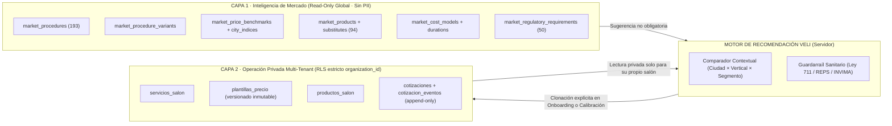

# Hoja de Ruta de Implementación y Arquitectura Desacoplada (`IMPLEMENTATION_ROADMAP`)

> **Objetivo arquitectónico (Fase 10):** Integrar la Base de Inteligencia de Mercado Colombia 2026 en Veli para potenciar onboarding, calibración de precios, «Sin Báscula», alertas regulatorias y recomendaciones de BI **sin mezclar ni sobrescribir jamás los datos privados multi-tenant (`organization_id`) de cada establecimiento**.

---

## 1. Arquitectura de Datos en Dos Capas Estrictamente Separadas

### Reglas de Oro de Integración en Supabase / Next.js 16
1. **Inmutabilidad y soberanía tarifaria del salón:** Actualizar trimestralmente `market_price_benchmarks` o `market_product_prices` **nunca** altera `servicios_salon` ni `plantillas_precio`. Cuando Veli detecta que un insumo subió `+18%` o que un servicio quedó bajo el punto de equilibrio, emite una **sugerencia accionable** en `/configuracion/precios`; si el propietario acepta, se inserta una **nueva versión inmutable** en `plantillas_precio` (`version + 1`).
2. **Vínculo opcional por `market_procedure_id`:** Agregar una columna opcional anulable `market_procedure_id text NULL` en `servicios_salon` permite comparar la tarifa y duración real de un salón contra el percentil de su ciudad y segmento sin obligarlo a usar los nombres estándar del mercado.
3. **Privacidad en rutas públicas (`/s/[slug]` y `/c/[token]`):** Ningún benchmark de costo, margen, merma ni alerta financiera interna se expone jamás en endpoints o vistas públicas; solo viajan hacia cliente final `nombre`, `descripcion_corta`, `duracion_minutos`, `es_precio_desde` y el precio público aprobado por el estudio.

---

## 2. Secuencia Priorizada de Implementación (`P0` → `P3`)

### Prioridad `P0` — Indispensable para el Cotizador, Onboarding y «Sin Báscula» (Inmediato)
1. **Corrección de gramajes base `1.0x` corto y separación de matiz:**
   - Actualizar las semillas de calibración para que `hair-balayage-completo`, `hair-babylights`, `hair-decoloracion-global` y `hair-correccion-color` partan de base corto (`60–80 g` decolorante) más componente separado de matizante (`40–60 g`), y que alisados/keratinas operen en `ml` (`60 ml` corto, unidad `onza_30ml`).
2. **Selector de Onboarding por Vertical, Ciudad y Segmento:**
   - Usar `price_benchmarks.csv` + `city_price_comparison.csv` para que un salón nuevo en Bucaramanga (`estandar`) o en El Poblado Medellín (`premium`) reciba al registrarse precios iniciales pre-calibrados a su realidad local en un clic, con total libertad de edición.
3. **Guardarraíles Sanitarios Críticos (`regulatory_matrix.csv`):**
   - Activar advertencia/confirmación de habilitación REPS (`Res. 3100/2019`) al habilitar *Dermapen*, *Depilación Láser Diodo* o *Drenaje Postoperatorio*, y alerta de registro `NSOC` libre de formol / libre de **TPO y DMPT** (`Res. INVIMA 2026007526`).
4. **Separación de Paquetes Multi-Cita:**
   - Permitir que paquetes como `lounge-paquete-novia-completo` generen 2 cupos independientes de agenda (Prueba `150 min` + Evento `180 min`) en vez de un bloque irreal de `180 min`.

### Prioridad `P1` — Inteligencia Real de Costos, Comisiones y Rentabilidad por Hora
1. **Extensión de Costeo Variable a `nail_bar`, `spa_estetica` y `beauty_lounge`:**
   - Incorporar `cost_tracking_mode` (`estructural_ml_g` y `monodosis_kit`) para descontar automáticamente monómero/polímero, polygel, sachets de lifting/laminado, gramos de cera y desechables obligatorios (`lima`, `sabanilla`, `guantes`, `cuchilla`).
2. **Calculadora de Costo por Minuto de Silla del Establecimiento:**
   - Capturar en `/configuracion/precios` 3 datos mensuales opcionales (arriendo + fijos + sillas activas) para reemplazar el promedio de mercado por el `cost_per_chair_min_cop` exacto del salón y revelar su **Utilidad Operativa Real por Hora Activa**.
3. **Simulador de Comisión Bruta vs. Neto Químico en BI:**
   - Mostrar con los propios tickets históricos del salón cuánto dinero anual recupera al migrar servicios químicos a `precio_menos_producto`.

### Prioridad `P2` — Crecimiento Comercial, Combos y Retención Automática por WhatsApp
1. **Expansión del Catálogo Maestro (`125` → `~185–193` procedimientos):**
   - Incorporar los procedimientos faltantes validados de alta tracción (*Extensiones capilares, AirTouch, Head Spa japonés, Volumen tecnológico en pestañas, Pedicura rusa, Masaje deportivo, Combos reales manos+pies*).
2. **Motor de Reactivación Pre-Ciclo y Llenado de Días Valle (`lun–mié`):**
   - Disparar sugerencias de envío por WhatsApp 4 días antes de cumplirse `return_frequency_days` (`14d` fade, `21d` acrílicas/pestañas, `30d` raíz/facial, `90–120d` balayage/keratina) y sugerir campañas estacionales según `seasonality.csv`.
3. **Sugerencias de Upsell / Add-ons en `/s/[slug]`:**
   - Usar `service_popularity.csv` para ofrecer 1 complemento compatible de alto margen durante la reserva online (ej. *Reparación Plex* en color, *Diseño de cejas* en corte/manicura, *Terapia LED* en limpieza facial).

### Prioridad `P3` — Actualización Continua y Expansión Regional LatAm
1. **Pipeline trimestral de actualización de `market_*`:**
   - Re-ejecutar `validateMarketIntelligence.mjs` cada trimestre incorporando inflación IPC/TRM de insumos importados y nuevas observaciones en ciudades intermedias.
2. **Benchmarking Anonimizado Opt-In (Efecto de Red Veli):**
   - Cuando una ciudad supere `>= 15` organizaciones activas en Veli, enriquecer los percentiles P25/Mediana/P75 con tarifas públicas agregadas y anonimizadas sin exponer jamás datos individuales de ningún negocio.
