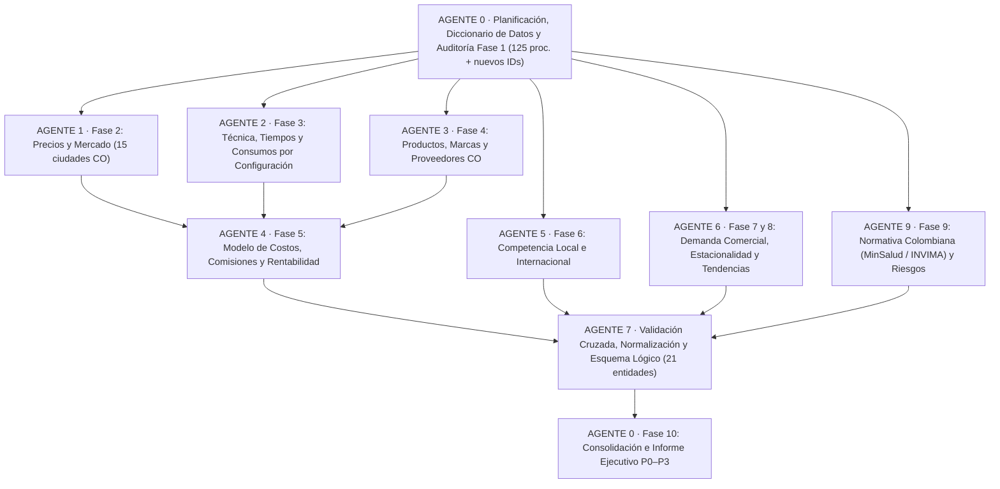

# Plan Maestro de Investigación e Inteligencia de Mercado · Colombia 2026

> **Rol Coordinador:** `AGENTE 0` — Market Intelligence Lead & Research Coordinator  
> **Rama aislada:** `research/market-intelligence-colombia-2026`  
> **Carpeta raíz de entregables:** `research/market-intelligence-colombia-2026/`  
> **Fecha de corte base:** `2026-11-27` (con distinción explícita entre tarifas observadas 2025–2026, referencias históricas y estimaciones técnicas)

---

## 1. Propósito Estratégico para Veli

Veli no compite como una simple agenda de citas ni como un ERP contable genérico. Su propósito es operar como el **sistema operativo de rentabilidad, fijación inteligente de precios, control de consumo («Sin Báscula») y crecimiento comercial** para establecimientos de belleza y bienestar en Latinoamérica.

Esta investigación construye el **activo fundacional de Inteligencia de Mercado Colombia 2026**, diseñado para responder con trazabilidad y evidencia:
1. **Qué catálogo ofrecer** por vertical (`hair_studio`, `barber_studio`, `nail_bar`, `spa_estetica`, `beauty_lounge`) sin sesgos ni vacíos comerciales.
2. **Cuánto cobrar** según ciudad, segmento del establecimiento (`economico`, `estandar`, `premium`) y complejidad real (largo, densidad, estructura, zona corporal).
3. **Cuánto cuesta ejecutar cada servicio**, separando estrictamente insumos químicos/materiales, consumibles desechables, pasarela de pago, mano de obra/comisión y costos indirectos asignables por minuto de silla.
4. **Cuánto tiempo consume realmente**, diferenciando ocupación total de silla/cabina frente a tiempo activo del especialista (p. ej. tiempos de pose en colorimetría).
5. **Dónde están las fugas de margen, los riesgos regulatorios en Colombia y las oportunidades comerciales desatendidas.**

---

## 2. Reglas Innegociables de Aislamiento y Rigor Metodológico

1. **Cero impacto en código productivo:** No se modifican migraciones SQL, RLS, rutas de API, pantallas, `lib/cotizador/*`, `lib/semilla-financiera.ts` ni el archivo `lib/catalogos/catalogoMaestroColombia.ts` (los 125 procedimientos se auditan sin sobrescribirse).
2. **Separación estricta entre Inteligencia de Mercado y Configuración del Salón:** Los precios sugeridos son **referencias contextuales**, nunca imposiciones obligatorias sobre las tarifas privadas (`organization_id`) de cada negocio.
3. **Separación estricta entre Costo de Producto y Costo de Servicio:** El modelo trabaja con **configuraciones y factores variables**, nunca con un gramaje rígido universal ni restando únicamente `precio - producto`.
4. **Trazabilidad y Nivel de Confianza obligatorio:** Todo registro declara `data_origin` (`observed`, `calculated`, `estimated`, `proposed`, `pending`) y `confidence_level` (`high`, `medium`, `low`, `unverified`). Ante muestra insuficiente, se reporta el tamaño de muestra y la limitación en lugar de inventar precisión.
5. **Recolección ética sin evasión:** Uso exclusivo de fuentes públicas verificables (`search_web` sobre plataformas de reserva con precios visibles, tarifarios públicos, distribuidores nacionales y normativa oficial colombiana), sin scraping agresivo ni evasión de bloqueos.

---

## 3. Arquitectura de Ejecución en Olas (10 Fases)

| Prioridad | Fases cubiertas | Impacto directo en Veli |
|---|---|---|
| **P0** | Fase 1 (Catálogo), Fase 2 (Precios), Fase 3 (Técnica/Tiempos/Consumo), Fase 4 (Productos) | Calibración real del Cotizador, recargos por complejidad y motor «Sin Báscula». |
| **P1** | Fase 5 (Costos, Comisiones, Punto de Equilibrio y Sensibilidad) | Cálculo real de margen bruto, margen de contribución, utilidad por hora y protección de margen. |
| **P2** | Fase 6 (Competencia), Fase 7 (Demanda/Estacionalidad), Fase 8 (Tendencias/Nuevos servicios) | Motor de recomendaciones comerciales, reactivación WhatsApp, combos y posicionamiento. |
| **P3** | Fase 9 (Normativa sanitaria/habilitación) y Fase 10 (Arquitectura de actualización continua) | Alertas de cumplimiento legal (cosmético vs médico) y escalabilidad regional LatAm. |

---

## 4. Esquema Lógico Objetivo (21 Entidades Normalizadas)

Documentado en detalle en [`DATA_DICTIONARY.md`](./DATA_DICTIONARY.md) y tipado en [`../schema/marketIntelligenceSchema.ts`](../schema/marketIntelligenceSchema.ts):

1. `market_categories`
2. `market_procedures`
3. `market_procedure_variants`
4. `market_sources`
5. `market_establishments`
6. `market_price_observations`
7. `market_price_benchmarks`
8. `market_suppliers`
9. `market_products`
10. `market_product_prices`
11. `market_procedure_formulas`
12. `market_procedure_consumables`
13. `market_procedure_durations`
14. `market_commission_models`
15. `market_cost_models`
16. `market_competitors`
17. `market_competitor_features`
18. `market_demand_observations`
19. `market_trends`
20. `market_regulatory_requirements`
21. `market_validation_issues`
